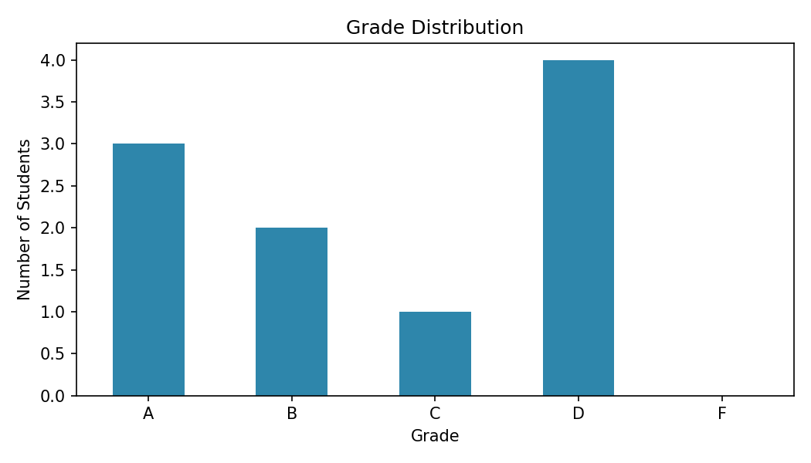

# Student Marks Evaluation System

A Python tool that applies bonus marks, then calculates totals, averages,
ranks, grades and pass/fail status for a class using NumPy and Pandas.
It exports an Excel report and a grade distribution chart.

## Features
- Adds bonus marks with a cap at 100
- Calculates total, average and class rank
- Assigns letter grades and pass/fail status
- Class summary: average, topper and pass rate
- Exports results to Excel
- Generates a grade distribution chart

## Tech Used
Python, NumPy, Pandas, Matplotlib

## How to Run
1. Open `student_marks_evaluation.ipynb` in Google Colab
2. Click **Runtime > Run all**

## Sample Output

The full results table is in `student_results.xlsx`.
